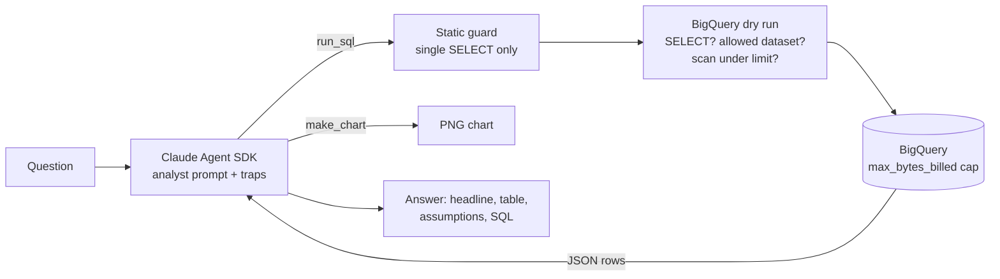

# Ask My Data

**An AI analyst agent that answers plain-English business questions with checked BigQuery SQL.**

Ask *"What's our average order value?"* and the agent plans a query, runs it read-only against BigQuery, checks its own result for the classic analyst mistakes, and replies with the number, a chart, its assumptions and the SQL it used.

Built with the [Claude Agent SDK](https://code.claude.com/docs/en/agent-sdk/overview) on Google's public [TheLook e-commerce dataset](https://console.cloud.google.com/marketplace/product/bigquery-public-data/thelook-ecommerce) (a fictitious clothing store: ~125K orders, 100K customers, 2.4M web events).

Example answer (abridged; figures from the Oct 28, 2026 data):

```text
$ ask-my-data "What is our average order value?"

**AOV is $85.97** across 93,778 completed or in-progress orders.

| Metric | Value |
|---|---|
| Net revenue | $8,062,107.98 |
| Net orders | 93,778 |
| AOV | $85.97 |

**Assumptions:** net revenue excludes cancelled and returned orders; orders are dated by
`orders.created_at`. Average *item* price is $59.36, which is not the same as AOV.
...
```

---

## Why this project

Text-to-SQL demos usually stop at "the query ran." In real analytics work, the query running is the easy part; the hard part is that **it ran and returned a plausible wrong number.** This project is about the second part:

- a **data dictionary** that documents the traps in the data, found by profiling it first,
- an agent prompt that turns those traps into **rules and self-checks**,
- an **eval suite** that grades every answer against an independently written reference query,
- and **layered safety** so the agent can only ever read.

## The bug the evals caught

During testing, the agent answered *"What's our AOV?"* with **$85.51**. An independent check query said **$85.97**.

The cause: `order_items.created_at` does not match its order's `orders.created_at`. Item timestamps are off by hours to days in both directions, and ~1,400 items on already-placed orders carry *future* dates. The agent filtered "to date" on the item timestamp, which silently dropped part of 895 orders. The same mistake understated 2026 revenue by **$54K**.

The fix became a rule (*date every sale by `orders.created_at`*) and a permanent eval check that fails any answer whose SQL filters on the item timestamp. It's the kind of error that passes code review because the SQL looks reasonable.

## Architecture



| File | What it does |
|---|---|
| [`src/ask_my_data/prompts/system.md`](src/ask_my_data/prompts/system.md) | The analyst's instructions: workflow, metric definitions, 12 documented traps, self-checks |
| [`src/ask_my_data/agent.py`](src/ask_my_data/agent.py) | Agent SDK setup. Built-in tools are switched off (`tools=[]`), so the agent can't run shell commands or edit files; it only has the three tools below |
| [`src/ask_my_data/tools.py`](src/ask_my_data/tools.py) | `run_sql`, `describe_table`, `make_chart`, served in-process as an SDK MCP server |
| [`src/ask_my_data/bigquery_client.py`](src/ask_my_data/bigquery_client.py) | Three safety gates before any query is billed (see below) |
| [`src/ask_my_data/sql_guard.py`](src/ask_my_data/sql_guard.py) | Static read-only check |
| [`evals/`](evals/) | 8 tricky questions, independent reference SQL, automatic grading |
| [`docs/data_dictionary.md`](docs/data_dictionary.md) | Tables, joins, metric definitions and traps, from profiling the data |

### Safety: the agent can only read

1. **Static check**: one statement, starting with `SELECT`/`WITH`, no `INSERT`/`UPDATE`/`DELETE`/`CREATE`/`DROP`/scripting keywords outside string literals.
2. **BigQuery dry run** (free): BigQuery itself must report `statement_type == "SELECT"`, every referenced table must be in the allowed dataset, and the scan must be under the byte limit.
3. **Hard cost cap**: the real job runs with `maximum_bytes_billed`, so BigQuery refuses anything larger.

Refusals are returned to the model as tool errors, so it can rewrite the query instead of crashing.

## Data traps the agent handles

From profiling all seven tables (full detail in the [data dictionary](docs/data_dictionary.md)):

| Trap | What goes wrong | Rule |
|---|---|---|
| Revenue lives in `order_items` | `orders` has no price column | Sum `order_items.sale_price` |
| Join fan-out | Orders × items double-counts orders | `COUNT(DISTINCT order_id)` |
| Cancelled & returned | Including them inflates revenue ~33% ($10.7M vs $8.1M) | Default to net revenue and say so |
| **Item timestamps** | Splits orders, understates totals | Date sales by `orders.created_at` |
| Two `traffic_source` columns | Sign-up channel vs visit channel use different categories | Pick by question type, state which |
| Dirty countries | "Spain" and "España" | Normalize before grouping |
| Anonymous sessions | 46% of events have no user; per-user conversion reads 99.9% | Session-based conversion only |
| Partial periods | This month looks like a drop (or a spike) | Compare per-day averages, flag >50% changes |

## Evaluation

`evals/run_evals.py` asks the agent each question in [`evals/cases.py`](evals/cases.py) and grades it against a reference query written separately, using different joins where possible (e.g. margin via `inventory_items.cost` instead of `products.cost`). It also grades **behaviour**: an answer with the right number still fails if its SQL filtered sales on the item timestamp.

| Case | Trap tested | Reference (Oct 28, 2026) |
|---|---|---|
| `orders_last_month` | Calendar boundaries | 5,499 |
| `aov` | Item timestamps; per-order, not per-item | $85.97 |
| `top_traffic_source` | Two traffic-source columns | Search: $5.62M |
| `spain_revenue` | "Spain" + "España" | $329,774 |
| `top_margin_category` | Margin on net items | Outerwear & Coats: $553,017 |
| `conversion_rate` | Anonymous sessions | 26.36% |
| `revenue_ytd` | Item timestamps; partial month | $2.90M |
| `campaign_profit` | Unanswerable (no campaign data) | Must say so |

The dataset is regenerated regularly, so reference values are recomputed on every run rather than hard-coded. Results are written to `evals/results.md`.

**History:** the first manual run scored 7/8; the AOV failure exposed the timestamp bug above. Dating by `orders.created_at` gives $85.97, matching the reference, and the eval now checks for the bug on every run.

## Setup

You need Python 3.10+, a Google Cloud project (the free [BigQuery sandbox](https://cloud.google.com/bigquery/docs/sandbox) works, no credit card) and an [Anthropic API key](https://console.anthropic.com/). The Agent SDK package bundles its own runtime, so there is nothing else to install.

```bash
git clone https://github.com/nannubabu/ask-my-data.git
cd ask-my-data
python -m venv .venv && source .venv/bin/activate
pip install -e ".[dev]"

gcloud auth application-default login       # lets the BigQuery client use your Google account
cp .env.example .env                        # then fill in the two values
export $(grep -v '^#' .env | xargs)
```

## Usage

```bash
ask-my-data "Which product category has the highest return rate?"
ask-my-data --verbose --show-sql "Revenue by month this year"   # watch the tool calls
ask-my-data                                                     # interactive mode

python evals/run_evals.py --references   # check reference queries only (no API cost)
python evals/run_evals.py                # full eval run -> evals/results.md
pytest                                   # 46 offline unit tests, no credentials needed
```

Charts are saved to `outputs/`.

## Using it on your own data

Point `ASK_MY_DATA_DATASET` at your dataset, then replace the tables, metric definitions and traps in `prompts/system.md`. The safety layer works on any BigQuery dataset. The real work, as in this project, is profiling the data first and writing down what can go wrong.

## Second dataset: TTC bus delays (real, messy data)

[`ttc/`](ttc/) applies the same process to **107,349 real TTC bus delay reports** from Toronto's open data portal (Jan 2025 to Sep 2026): load, profile, clean, validate, then let the agent answer questions.

- **Cleaning:** removed 429 duplicates, merged 591 route-name spellings into 274 routes, fixed 130 wrong weekdays, gave four codes all called "OTHER" unique labels, and flagged zero-minute, 3-hour+ and placeholder delays instead of silently dropping them.
- **Validation:** 18 SQL checks prove the clean table still adds up to the raw upload (same rows after de-duplication, same delay minutes, same days); all pass.
- **A fix that was reversed:** filling missing routes from the same bus's other trips looked reasonable, but a spot check showed every such report was at a bus garage, so the rows were left as missing.

See the [TTC write-up](ttc/README.md), [data dictionary](ttc/data_dictionary.md) and [SQL](ttc/sql/).

## Limitations

- The traps are specific to this dataset; a new dataset needs its own profiling.
- The number grader looks for the expected value anywhere in the answer, so a long answer full of numbers could pass by coincidence. The behaviour checks (forbidden SQL) reduce but don't remove this.
- TheLook is synthetic; some patterns (like October 2026 running at twice September's daily rate) are artifacts of how it's generated, and the agent is told to say so.

## License

MIT
